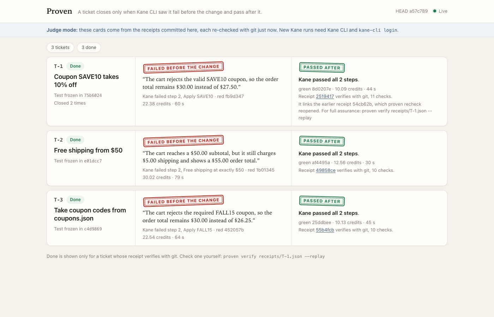
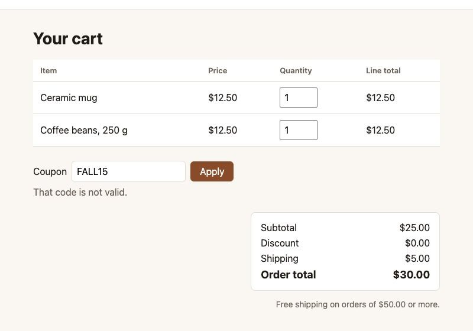
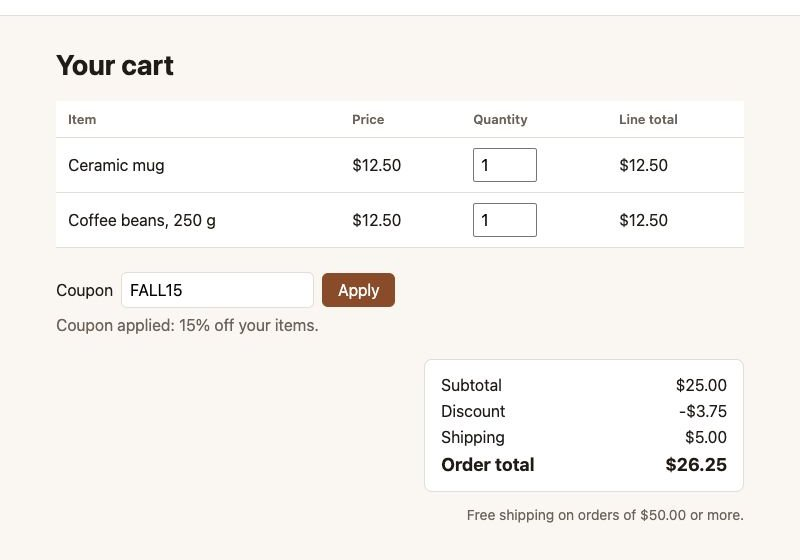
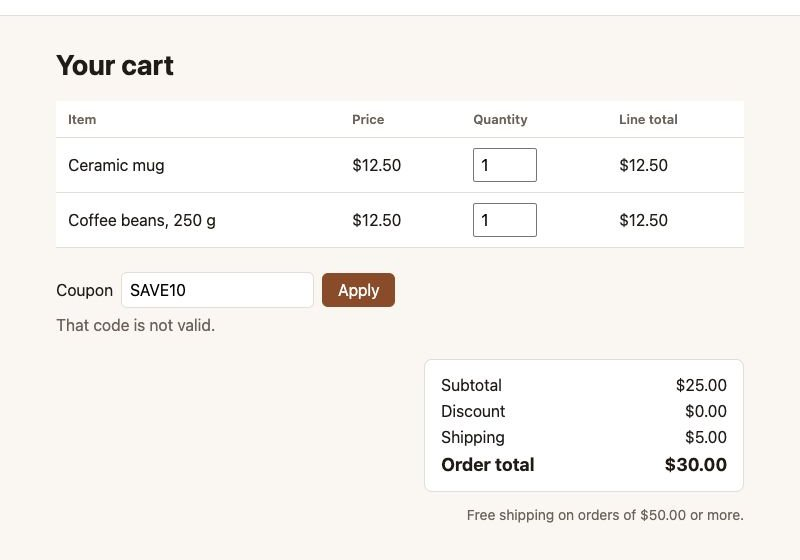
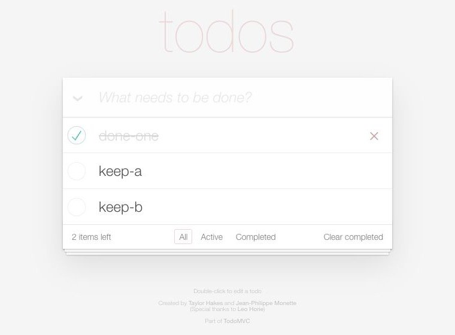
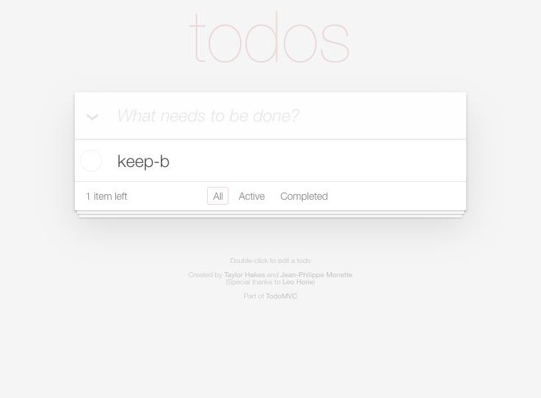
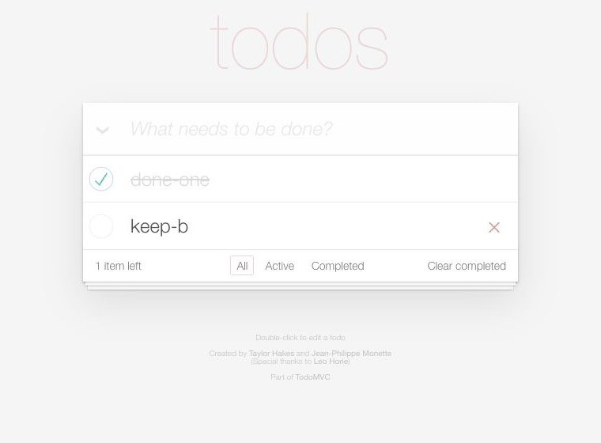

# Proven

[](https://github.com/vijaygopalbalasa/proven/actions/workflows/ci.yml)

Proven is a ticket board for coding agents. A ticket only closes after Kane CLI has seen its frozen test fail before the change and pass after it.

I built it because my coding agent kept saying a ticket was done when it wasn't. Here, a person writes the ticket and freezes its test first. Kane has to fail that test on the code as it is. After the agent's change, Kane has to pass the same, unchanged test.

Then Proven reruns Kane on every closed ticket. If a later change breaks one, fresh Kane runs reopen it and the loop gives it back to the agent. Nobody types anything in between. Three words I use: frozen means the ticket and its test are committed and locked before any work starts, red means Kane fails that test on the code as it was, and green means Kane passes the same unchanged test after the change.



## Two bugs I didn't plant

I pointed Proven at two open issues on the TodoMVC examples, bugs another person reported. Each case repo has the ticket, Kane's red, the fix and the receipt.

- **Mithril, tastejs/todomvc#2312.** Deleting a todo in the Active view deleted a different, hidden todo. Kane's red: "The final check expected two todos, but the page contained only keep-b after the All filter was selected." Claude Code changed delete and edit to use the todo itself instead of its position in the filtered list. Kane passed the same frozen test. The receipt verifies, and three full replays agreed: Kane failed it at red and passed it at green. Case repo: https://github.com/vijaygopalbalasa/proven-todomvc-2312
- **ES5, tastejs/todomvc#2310.** "Mark all as complete" stayed unticked after ticking every todo. Kane's red: "After completing both todo items, the Mark all as complete checkbox was still not checked." The fix was one line (`checked` was set on the label, not the input), and it covers all three cases in the issue. Case repo: https://github.com/vijaygopalbalasa/proven-todomvc-2310

A fix for each is ready for upstream.

## Try it

No install, no login (needs Node.js 22 or newer). This shows the board over the receipts committed here:

```
git clone https://github.com/vijaygopalbalasa/proven proven
cd proven
npm start          # then open http://127.0.0.1:8090/
```

To use Proven without cloning it, `npx github:vijaygopalbalasa/proven --help` runs it straight from GitHub (see "Use it on your own static app").

The cheapest live check is a replay. `node bin/proven.js verify receipts/T-1.json --replay` needs Kane CLI and `kane-cli login`. It checks the receipt with git, then has Kane run the frozen test again with the app at red (it must fail) and at green (it must pass). I measured it on Nov 14: about 29 Kane credits (11 for the red run, 18 for the green run) and 2.5 to 3.5 minutes, depending on how busy the machine was. Port 8091 must be free.

Demo video (2:53): https://youtu.be/A4ITb2efKEk

## What Kane saw (its own screenshots)

Six of Kane CLI's own step screenshots, cropped to the page. The first row is the demo shop's cart. The second row is the Mithril bug from "Two bugs I didn't plant":

<table>
<tr>
<td width="33%"><br><sub>T-3 before the change: Kane typed FALL15, the shop said "That code is not valid." and the total stayed $30.00 (red).</sub></td>
<td width="33%"><br><sub>T-3 after the change: the same test, "Coupon applied: 15% off your items." and the total is $26.25 (green).</sub></td>
<td width="33%"><br><sub>T-1 on the recheck: SAVE10 typed, "That code is not valid." and $30.00, so T-1 reopened.</sub></td>
</tr>
<tr>
<td width="33%"><br><sub>Before the delete: done-one is completed, keep-a and keep-b are active.</sub></td>
<td width="33%"><br><sub>Red: Kane deleted keep-a in the Active view, then opened All. done-one, which nobody clicked, is gone.</sub></td>
<td width="33%"><br><sub>Green: the same frozen test after the change. done-one and keep-b remain.</sub></td>
</tr>
</table>

## For judges

1. **See it (30 seconds).** `npm start` shows the board over the receipts committed here. Each card's receipt is re-checked with git when the board loads. No install, no login.
2. **Replay a receipt.** The cheapest live check is under "Try it" above.
3. **Run the tests.** `npm test` runs 177 tests, every command end to end, on a fake Kane (no login). It takes about 3 to 4 minutes, longer on a busy machine.
4. **See Kane fail a test yourself, then run the whole loop.** Both start on the branch `try-it`, where T-3 of the demo shop is written but not frozen. About 30 credits and 1 minute for the red, about 225 to 280 credits and 15 minutes for everything.
5. **If you can't run Kane.** The receipts and state of the recorded run are committed, `verify` works offline, and [docs/recorded-run.md](docs/recorded-run.md) has the terminal output of the run line by line.
6. **Dates.** The first commit is `68295c6`, at 2026-11-13 02:20 IST (Nov 12 20:50 UTC). The history is as written.

<details>
<summary>The exact steps for item 4, the costs, and what you need for the live steps</summary>

See Kane fail a test yourself (about 30 credits, about 1 minute). Needs Kane CLI and `kane-cli login`. On the branch `try-it`, T-3 is written but not frozen:

```
git checkout try-it
node bin/proven.js freeze T-3      # a person freezes the ticket's test
node bin/proven.js red T-3         # Kane must fail it on the shop as it is
```

You should see Kane pass step 1 and fail step 2, with its own words for why.

Run the whole loop. Continue on the same branch:

```
node bin/proven.js loop            # the agent, Kane and the recheck, in one command
node bin/proven.js verify receipts/T-1.json --replay
```

Measured: `red` about 30 Kane credits and 1 minute. `loop` about 170 credits and 11 minutes. Both steps together with the final replay: about 225 to 280 credits and 15 minutes. Port 8091 must be free.

What you need for the live steps:
- Kane CLI with `kane-cli login`, and network access to Kane's cloud and to Anthropic.
- Google Chrome.
- Claude Code (`claude`) for the loop. It runs headless (`claude -p`) on your own account and quota, and its first run in a folder may ask you to trust it. It is the only agent I tested (see [docs/loop.md](docs/loop.md) for others).
- Node.js 22 or newer (CI runs 22 and 24) and git with `user.name` and `user.email` set.
- I tested on macOS (Node 24) and on Linux (Node 22 and 24, in Docker).

</details>

### How the demo is set up

I wrote ticket 3 so that its obvious fix (take the coupon codes from `coupons.json`) breaks ticket 1 (requirement 8.1 in [docs/requirements.md](docs/requirements.md)). The agent took that fix in all 4 live runs:

- Two rehearsals in throwaway copies, whose logs are not in this repo. T-1 reopened at `a51f39f` and at `ed46d29`, commits from those copies.
- The recorded run below, where T-1 reopened at `fb9d347`.
- A run from a fresh clone of `try-it` that followed only this README. It also reopened T-1, and it is not in this repo's history.

Each reopen was a fresh Kane run that failed, then a second fresh run that agreed. The reopen happened every time because I set it up to. I'm not claiming the agent walked into it by accident.

In my runs the agent never tried to edit a test, so the guard never blocked anything live. [docs/guard.md](docs/guard.md) shows it blocking when called the way Claude Code calls it.

## The recorded run

On Nov 13 (06:13 to 06:28 IST), starting from `14e9664`, one `proven loop` ran against live Kane CLI and Claude Code.

- `proven freeze T-3`: ticket and test in `c4d9869`, lock in `452057b`. `proven red T-3` at `452057b`.
- `proven loop` (one command, exit 0, 10 min 42 s): the agent fixed T-3 on its first attempt (green `25ddbee`, receipt `fb9d347`).
- The loop's recheck ran T-1 fresh twice and both runs failed, so T-1 reopened at `fb9d347` (state commit `e5e609b`).
- The loop handed T-1 back. The agent edited `demo/app/coupons.json` and ran done (green `8d0207e`, receipt `d3b9389`, which links the earlier receipt). The final recheck: all three tickets still pass.
- `proven verify receipts/T-1.json --replay`: CONFIRMED, 11 git checks. Kane failed step 2 at red `fb9d347` and passed at green `8d0207e`.
- The whole take used about 207 Kane credits.

Kane's words and the agent's, with times, are in [docs/recorded-run.md](docs/recorded-run.md).

## How it works

A person writes a ticket and freezes its test. Kane must fail that test on the code as it is (red). The agent then changes the app and runs `proven done`, and Kane must pass the same test (green). Proven never judges pass or fail itself. It runs Kane, reads Kane's events, checks hashes and git history, and writes a receipt that anyone can re-check.

## Install

- Node.js 22 or newer and git. Proven has no dependencies to install.
- For live runs: Kane CLI (`npm install -g @testmuai/kane-cli`), Google Chrome, and `kane-cli login`.
- For the agent loop: Claude Code (`claude`).

```
npm test       # every command, end to end, on a fake Kane: no login needed
npm start      # judge mode: the board over the receipts committed here, at http://127.0.0.1:8090/
```

Run `npm link` once to call Proven as `proven`. The commands below use `node bin/proven.js`, which works without it.

## Verify, recheck, board

- **Verify.** `proven verify receipts/T-N.json` checks the receipt's own hash, that the frozen test matches, that the
  lock was written once right after it, that red is an ancestor of green, that the test did not change in between,
  that the app trees match and changed, and that the state history shows this red. With `--replay`, Kane runs the
  frozen test fresh at the red commit (must fail at the recorded step) and at the green commit (must pass). A replay
  gets twice the time limit pinned at freeze. If it does not complete, for example because Kane runs past that limit after
  the red step, the headline reads `CONFIRMED (git checks only)`, the last line says what Kane did, and the exit code is 2.
- **Recheck and reopen.** `proven recheck` runs every done ticket's frozen test again against the app as committed now,
  with `--no-adaptive-heal`. A failure is confirmed by a second fresh run before anything changes. Only a confirmed
  failure reopens the ticket, in a state commit of its own, and the new receipt links the earlier one.
- **Board.** `proven board` (or `npm start`, in judge mode) serves a local page with each ticket's state and evidence in
  plain words. It updates live, shows done only for a receipt that verifies with git, and listens on 127.0.0.1 only.

## The loop

`proven loop` hands each red or reopened ticket to the coding agent, one ticket at a time, shows the agent's tool calls,
its words and Kane's verdicts as they happen, rechecks every done ticket from its own code, and hands back what
reopens, for at most 2 rounds. It never trusts a verdict made inside the agent's session: after every session it checks
git and file hashes first. Details, the agent command, using an agent other than Claude Code (untested) and exit codes: [docs/loop.md](docs/loop.md).

## The guard

`proven init` writes a Claude Code hook. The agent can read files, run `node bin/proven.js done T-N`, and edit files only inside the app folder named in `.proven/config.json`: the edit tools are blocked everywhere else. Bash is blocked unless every command is `proven done` or on a short read-only allowlist. An MCP tool call is blocked if it names a protected path (`tickets`, `receipts`, `.proven`, `.git`, `.testmuai`, `.mcp.json`, `CLAUDE.md`, Proven's own code), if a path-like argument points outside the app folder, or if the guard cannot check every argument. If it cannot read a tool call, or fails, it blocks the call. It is not a sandbox. Details: [docs/guard.md](docs/guard.md).

## Use it on your own static app

The two case repos above are real runs on TodoMVC bugs. Two earlier runs, on a feature I added to the vanilla JavaScript TodoMVC example, are in [docs/own-app.md](docs/own-app.md),
with real Kane and Claude Code. Kane failed a new "Clear completed (2)" test on it, Claude Code made the one-line fix,
Kane passed it, and `proven verify` printed CONFIRMED. What those runs show:

Install Proven first. Pick one:

```
npx github:vijaygopalbalasa/proven --help          # no install: put this in front of every command below instead of `proven`
npm i -g github:vijaygopalbalasa/proven            # puts `proven` on your PATH, which `proven loop` needs for the agent
git clone https://github.com/vijaygopalbalasa/proven && cd proven && npm link    # from a clone (Node 22 or newer)
```

In a test on Nov 14, `npx` took 7 seconds cold and the global install took 4 seconds. Then, in your own repository:

```
cd your-repo                                # a git repository with a static app in a folder, for example site/
mkdir -p .proven && echo '{ "app": "site" }' > .proven/config.json
proven init                                 # writes into your repo: the guard hook (.claude/), CLAUDE.md and .gitignore lines
git add -A && git commit -m "Add Proven"    # freeze refuses until these are committed
proven new T-1 "Your feature" --url http://localhost:8095/ --landmark "text on the page"
# fill in tickets/T-1.md: plain steps, each criterion ending in a Verify line (see below)
proven freeze T-1 && proven red T-1         # Kane must fail it on your app as it is
```

Then pick one:

```
proven loop                                 # Claude Code fixes the app, Kane passes it, a receipt is written
# or, by hand: change the app yourself, then
proven done T-1                             # Kane runs the frozen test on your change and writes the receipt if it passes
```

Each Kane run prints the credits it used. `proven verify --replay` is two Kane runs, so it costs about twice a `red`.

- `--url`: any free local port works. Proven serves your app folder there while Kane runs, and the page must show the
  landmark text.
- The criterion I used on TodoMVC (the whole `tickets/T-1.md` and the commands are in [docs/own-app.md](docs/own-app.md)):
  ```
  ### Clear completed shows the count
  Type Buy milk in the What needs to be done field and press Enter. Do the same for Walk dog and for Pay rent. Click the round checkbox next to Buy milk and the one next to Walk dog.
  Verify the button at the bottom right of the list reads Clear completed (2).
  ```
- "The agent can start" in `proven red`'s output means `proven loop` can now run. Nothing starts the agent until you run it, and `proven done` works the same if you make the change yourself.
- Writing a criterion Kane can check: name the exact labels the feature will have (a button's text, a heading), check the lasting state of the page rather than a message that disappears, keep to one action per step, and leave step 1 to Proven (it checks your landmark text). Then read Kane's words at red before you run the loop, because a red can fail for a different reason than the one you meant. The ticket template says the same.
- For a longer test, raise `timeout_s` in `.proven/config.json` before you freeze. The lock pins it, and a replay gets twice that limit. Kane runs are cut off at 300 s by default, and both TodoMVC cases had a run cut off.
- Times on TodoMVC: `red` about 2.5 minutes (its step 2 alone took 107 s in one run), `proven loop` about 5 minutes.

What works, and what does not:

- **Static files only.** Proven serves the app folder itself while Kane runs. There is no build step and no server of
  your own.
- **The app folder** must be inside the repository and not `tickets`, `receipts`, `.proven`, `.git`, `.claude`, `.testmuai`, `.mcp.json`, `.gitattributes`, `.gitmodules`, `CLAUDE.md`, `src`,
  `bin`, `test`, `docs`, `node_modules`, `package.json`, `package-lock.json`, `README.md` or `.gitignore`: the guard keeps
  the agent out of those, so Proven refuses such a config. Use a folder like `site/` or `public/`.
- **The agent can edit only the app folder.** It cannot touch your tests, docs or config.
- **Needs** Kane CLI with `kane-cli login`, Chrome, Claude Code, `proven` on PATH, and a start URL with a free local port.
  Kane CLI runs Chrome for its steps (its own help: `--headless` "Run Chrome in headless mode"), so install Google Chrome.
- **Tried on one other app so far:** TodoMVC, in four runs (two on a feature I added, each with one agent attempt, and the two bug cases above). I have not shown a recheck that reopens something on an app of someone else's.

## Commands

| Command | Who | What it does |
|---|---|---|
| `proven new T-N "<title>" [--url U] [--landmark L]` | person | writes `tickets/T-N.md` to fill in |
| `proven freeze T-N` | person | writes `tickets/T-N_test.md`, commits ticket and test, then a lock naming that commit |
| `proven red T-N` | person | Kane must fail the frozen test on the code as it is |
| `proven done T-N` | agent | Kane decides. A pass commits the change and the receipt |
| `proven verify receipts/T-N.json [--replay]` | anyone | re-checks a receipt with git, and with `--replay` with Kane at red and green |
| `proven recheck [T-N ...]` | person or agent | runs done tickets' tests again and reopens one whose failure a second run confirms |
| `proven board [--port 8090] [--judge]` | anyone | the local board |
| `proven loop [T-N ...]` | person | hands each red or reopened ticket to the coding agent, shows the agent and Kane live, rechecks, hands back what reopens (at most 2 rounds) |
| `proven init` | person | the Claude Code guard rails |

Exit codes for `verify`: 0 confirmed (with `--replay`, Kane agreed), 1 mismatch, 2 `--replay` was asked for but did not complete (only the git checks ran). Exit codes for `red` and `done`: 0 ok, 1 Kane failed (or, at red, the test already passes), 2 did not run. For
`recheck`: 0 all still pass, 1 a ticket reopened, 2 something did not run. For `loop`: 0 all done and the last recheck passes, 1 needs
a person, agent stopped without a green or a reopen at the end, 2 something did not run.

## Limits

- Receipts and local checks show tampering, they do not prevent it. An agent with a shell can forge local git history, and Kane does not sign receipts. The stronger check is `verify --replay`, where Kane runs the frozen test again at red and at green, ideally on someone else's machine. `proven loop` checks what it can see.
- The guard is not a sandbox. It blocks writes to Proven's own code, and `proven loop` checks git and file hashes after every agent session, but an agent with a shell can still try to get around both.
- Run Proven as the user who owns the clone. Git refuses repositories owned by someone else ("dubious ownership"), and Proven does not read your global `safe.directory`, so it then says "Run proven inside a git repository".
- Proven runs git without your global git config. If the repository has no `user.name` or `user.email` of its own, it reads yours once from `git config --global` at startup, and refuses to commit if there is none.
- The app must be static files. Proven serves its own snapshot of the app folder while Kane runs, and the start URL must be local with a port, like http://localhost:8091/.
- Proven cannot tell a red for the wrong reason from a red for the right one. It only checks that the landmark step passed (so an outage is not red) and that a later step failed. Read Kane's words at red before you run the loop.
- Kane's verdicts can be flaky. That is why red needs a passing landmark and a failing later step, why anything unclear counts as "did not run", and why recheck confirms a failure with a second fresh run before it reopens anything.
- Evidence packs are not committed, because they carry the runner's name and email. Proven keeps only their sha256. Six of Kane's step screenshots (the demo cart and a TodoMVC page, cropped) are in `docs/images`. Kane's recording folder (`tickets/output-T-N/`) stays local for the same reason and is never used for a verdict. So every run authors every step: a minute or two and about 10 to 30 credits each.
- `recheck`, `loop` and `verify --replay` run Kane, so they need Kane CLI, Chrome, a login and credits. All three ran live on Nov 13. The test suite uses a fake Kane through the `PROVEN_KANE_BIN` variable. Every run made that way says so in the output, the state and the receipt, and `verify` flags such a receipt.
- `--author` comes from Kane CLI 0.10.4's own help ("re-author every step"). It ran live on Nov 13 (every recheck run used it) and Kane accepted it. If Kane ever rejected it, every run would say "did not run", so nothing could pass by mistake.
- A file in Kane's output folder that someone else changes while Kane runs cannot be told apart by its time. Against that, Proven relies on `--author` and on Kane's own summary showing no replayed step.
- `recheck` judges the app as committed and refuses while the app folder has uncommitted changes.

## Files

`tickets/` holds tickets, frozen tests and locks. `receipts/` holds receipts. `.proven/state/` holds each ticket's red
record and attempts. `.proven/config.json` holds the app folder, the time limit and the attempt limit, which are
pinned when a ticket is frozen. For a longer test, raise `timeout_s` in `.proven/config.json` before you freeze. The lock pins it, and a replay gets twice that limit. How a run counts, and what I measured about Kane: [docs/kane-facts.md](docs/kane-facts.md).
